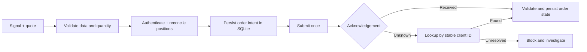

# Trading Reliability Demo

**Run six trading-system failure scenarios in seconds. No API keys, accounts, or dependencies.**

An independent portfolio demonstration of how I investigate broker-session failures,
stale market data, uncertain order outcomes, and inconsistent position state.
Written in Python using SQLite and the standard library.

[View the executed scenario report](examples/report.md) · [Read the tests](test_engine.py) · [Inspect the engine](engine.py)

## Run it

Python 3.10 or later:

```sh
python3 demo.py
python3 -m unittest -v
```

Save a fresh evidence report:

```sh
python3 demo.py --output examples
```

## What you can see

| Failure | Demonstrated behavior |
|---|---|
| Session expires | Reauthenticate before proceeding; block when authentication is unavailable |
| Quote is stale, future-dated, invalid, or for another symbol | Reject before submitting an order |
| Broker accepts an order but its acknowledgement is lost | Persist UNKNOWN; recover by reconciliation using the same client ID |
| The process restarts and the signal repeats | Recover the SQLite intent instead of blindly submitting again |
| Partial-fill updates repeat | Record cumulative fills without double counting |
| Position differs from the local ledger | Block the next order and record expected versus observed position |
| Broker rejects an order | Preserve rejection; a repeated signal does not retry it |

## Architecture



The simulator deliberately accepts an order and then throws a timeout. That reproduces
the important distinction between **a failed response** and **a failed order**.
Replay reconciles the existing intent. It does not assume retrying a submission is safe.

The database survives construction of a new engine instance. Tests also close and reopen
the connection to verify recovery independently of in-memory state.

## Engineering approach

I have 20 years of experience in trading systems, including C++ high-frequency trading work,
Python, and trading/market-data interfaces. I use AI-assisted development to accelerate
implementation, then validate behavior with reproducible tests and observable evidence.

This repository is an original portfolio example motivated by common trading-engine
requirements. It contains no client code, proprietary strategy, client identity, or
production credentials. It does not claim that a specific customer's incident has been
diagnosed or fixed.

## Scope and next integration step

This is a **single-worker, buy-only offline reference**, not a production broker adapter.
The simulated broker keeps its own state in memory, standing in for a broker that survives
a local application restart. It assumes order lookup by a stable client ID and cumulative
fill quantities. A real integration must establish what the venue actually supports.
Position reconciliation assumes an isolated symbol with zero starting inventory; importing
pre-existing inventory and separating multiple strategies require an explicit baseline.

It does not connect to IG or a crypto exchange, implement their authentication protocols,
execute live orders, or validate a strategy's profitability. Multi-worker coordination,
cancel/replace flows, short positions, broker restart behavior, and full risk controls
are outside this demo.

For an actual engagement, the next step is to inspect the existing adapter and sanitized
logs, map these scenarios to the venue's documented semantics, and reproduce the relevant
failure before proposing a focused patch.

## A small first engagement

A focused diagnostic can start at **$150**, with scope agreed after reviewing the materials:
one issue or component, reproducible evidence, findings, limitations, and next steps.
A bounded module implementation can be quoted separately.

## Files

- `engine.py`: durable intent, validation, state reconciliation, and simulated broker.
- `test_engine.py`: executable behavioral and failure-path tests.
- `demo.py`: six scenarios and generated evidence.
- `examples/`: output generated by the demo, including structured event traces.
- `.github/workflows/tests.yml`: Python test and demo execution in CI.

MIT licensed. This demo may be adapted to a new project; it is not a copy of client work.
